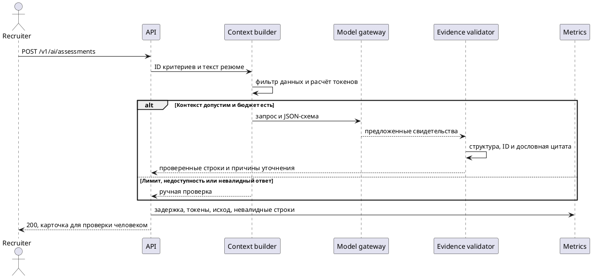

# Лаба 2. AI-пайплайн проверки резюме AZPU

Сценарий AI-01. Рекрутер выбирает вакансию, вводит до восьми обязательных требований и отправляет текст одного резюме. Сервис возвращает свидетельства по каждому требованию и вопросы, которые стоит задать на интервью. Решение о приглашении принимает рекрутер.

## Путь запроса в PlantUML

Исходник диаграммы также доступен как [ai-pipeline.puml](architecture/ai-pipeline.puml).

## Границы контекста и обработка сбоев

| Этап | Что делает | Где проверяем |
| --- | --- | --- |
| Приём | API принимает текст, уже извлечённый из файла, и рубрику вакансии. Версия рубрики фиксируется в запросе. | Есть от 1 до 8 требований с уникальными ID. Пустой текст и неверная структура дают 422. |
| Подготовка | Удаляем контактные и биографические поля, режем текст на нумерованные фрагменты по абзацам. Цитаты привязаны к очищенному тексту. Документ передаём отдельным полем данных. | Модель видит только версию рубрики, требования и ограниченные фрагменты резюме. Сумма после токенизации не выше 2 000 входных токенов. При превышении ручная проверка сохраняет доступ ко всему исходному тексту. |
| Модель | Прямой запрос с JSON-схемой. Выход содержит кандидаты свидетельств, по одному фрагменту на критерий. Нет инструментов, внешнего поиска, истории других резюме, пользовательских профилей или секретов. | Таймаут 5 с на модель, максимум одна попытка. Переход на дешёвую модель возможен до запроса при лимите тарифа. Сбой после запроса ведёт к ручной проверке. |
| Верификация | Сверяем ID критерия и фрагмента, извлекаем действительные смещения дословной цитаты и нормализуем результат. Строки с непроверенным свидетельством получают вопрос для интервью. | Поломка структуры блокирует весь вывод модели. Ошибка одной строки снижает только этот критерий. Даже дословное совпадение остаётся подсказкой: рекрутер оценивает, доказывает ли цитата собственный опыт. |
| Ответ | Продукт показывает все критерии из запроса, цитаты или вопросы по пробелам. Подтверждения без цитаты сервер не возвращает. | Измеряем долю ответов с отбраковкой, ошибки по причинам, входные и выходные токены, p95 времени. Логи содержат только ID запроса, версию модели и промпта, счётчики, длительность и код исхода. Тексты, цитаты и PII в лог не пишутся. |

Сценарий может работать с синтетикой в облаке. Реальные резюме идут через утверждённый контур обработки, до его согласования сервис использует локальную ручную проверку. Никакой этап не меняет статус кандидата в HR-системе.

## Связанные документы

- [OpenAPI и примеры ответа](../api/openapi.yaml)
- [ERD хранения результата](architecture/ai-data-model.md)
- [Выбор модели, бюджет и деградация](model-candidates.md#решение-для-лабы-2)
- [Эксперимент: проверка ошибок формата и цитат](experiments/lab2.md)
