# ERD результатов AI-проверки

```mermaid
erDiagram
    VACANCY_REVISION ||--o{ REQUIREMENT : defines
    VACANCY_REVISION ||--o{ ASSESSMENT : uses
    ASSESSMENT ||--o{ RESUME_SEGMENT : reads
    ASSESSMENT ||--o{ FINDING : yields
    REQUIREMENT ||--o{ FINDING : explains
    RESUME_SEGMENT o|--o{ FINDING : supports
    VACANCY_REVISION {
        uuid id PK
        string display_revision
    }
    REQUIREMENT {
        uuid vacancy_revision_id FK
        string requirement_id
        string text
    }
    ASSESSMENT {
        uuid id PK
        uuid vacancy_revision_id FK
        string state
        string model_version
        string reason
    }
    RESUME_SEGMENT {
        uuid assessment_id FK
        string segment_id
        string redacted_text
    }
    FINDING {
        uuid assessment_id FK
        string requirement_id FK
        string segment_id FK
        string status
        int start
        int end
    }
```

Ключи REQUIREMENT и RESUME_SEGMENT составные. FINDING уникален по
`(assessment_id, requirement_id)`. Связь с требованием проходит через ревизию
вакансии ASSESSMENT, а ссылка на фрагмент ограничена тем же ASSESSMENT.
Подтверждённая строка имеет фрагмент и полуоткрытый диапазон символов
`[start, end)`. При ручной проверке фрагмент и смещения пусты. Храним только
очищенные фрагменты, необходимые для воспроизводимой карточки. Срок хранения
определяется политикой контура перед работой с реальными резюме.
